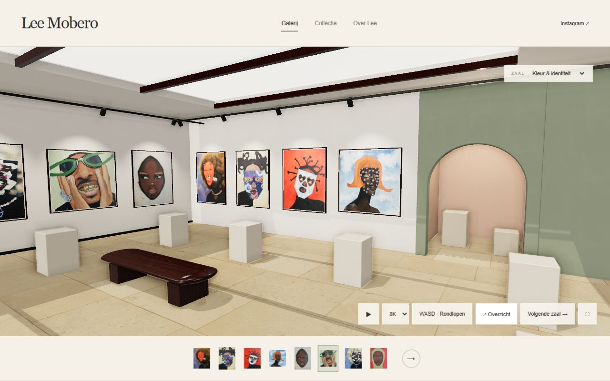

# Lee Mobero — digitale galerij

## Huidige versie: Blender-ruimte en materiaalbeheer

De website gebruikt nu de geëxporteerde Blender-ruimte (`images/models/gallery-concept/room.glb`) met afzonderlijk bewerkbare kunstwerken, sokkels, meubels, planten en bomen. De beheerbibliotheek bevat acht Poly Haven-salontafels en 869 materiaalopties. Negen materiaalsets staan lokaal klaar; overige sets worden op aanvraag via de beheerserver gedownload. De materiaalkeuze ondersteunt 2K/4K/8K-kleurtextures, 2K-normal/roughnessmaps, patroonschaal en reliëfsterkte. De oorspronkelijke ruimtematerialen zijn op 2K gebakken.

GitHub Pages publiceert uitsluitend de bezoekerssite en de daar gebruikte modellen/materialen. De volledige assetbibliotheek en beheercode staan wel in deze repository. Loginbestanden, privéconcepten en grote Blender-werkbestanden blijven lokaal. Live weer op bezoekerslocatie en materiaaldownloads vereisen de Node-server; GitHub Pages ondersteunt deze serverfuncties niet. Dag/nacht, handmatige weerskeuze en daglicht werken wel op de statische site.

De onderstaande ontwerpnotities beschrijven deels het eerdere prototype; de actuele Blender-ruimte heeft een vaste geometrie, twaalf actieve kunstspots en realtime PBR-verlichting. Dit is geen Gaussian-splat- of path-tracingrenderer.

Een uitbreidbare 3D-galerij met de 11 originele afbeeldingen uit [Leemobero/Leemobero](https://github.com/Leemobero/Leemobero), aanpasbare lijsten en een afzonderlijke beheerapplicatie. Het ontwerp is een nieuwe uitwerking; de huidige leemobero.com is niet gewijzigd.



De afbeelding hierboven is de werkende webgalerij. Het [gegenereerde sfeerontwerp](design/gallery-concept.png) staat apart ter vergelijking.

## Bekijken

De bezoekerssite is volledig statisch en geschikt voor GitHub Pages. Zet bij **Settings → Pages → Source** de bron op **GitHub Actions**; de meegeleverde workflow bouwt uitsluitend de openbare galerij. Er wordt geen eigen domein ingesteld. De beheerapp wordt niet naar Pages gekopieerd.

Lokaal, met Node.js 22 of nieuwer:

```sh
node tools/server.mjs
```

- Galerij: http://127.0.0.1:4173
- Beheer: http://127.0.0.1:4174
- Eerste lokale gebruikersnaam en wachtwoord: `.local/beheer-login.txt`. Deze map is genegeerd door Git en niet bereikbaar via beide websites.

Desktop: klik **WASD · Rondlopen** voor muisbesturing, loop met WASD, en gebruik Esc om de muis vrij te geven. Slepen met de muis werkt ook. Mobiel: swipe om rond te kijken; tik op de vloer om naar een bereikbare plek te lopen. Tik op een kunstwerk voor een dichtbijzicht. Via de zaalkeuze of de boog open je de volgende zaal.

## Beeldkwaliteit en rondgang

De bezoekerssite opent rechtstreeks in de 3D-ruimte: https://miltonminecraft-afk.github.io/Lee-tests-omgeving-/

De camera gaat automatisch elke vijf seconden naar het volgende werk en vervolgens naar de volgende zaal. Handmatig kijken, lopen, een werk selecteren of de collectie openen pauzeert dit. De afspeelknop hervat de rondgang.

De ruimte heeft vier gesloten wanden, een afgesloten daklicht, gefotografeerde PBR-materialen, indirecte omgevingsverlichting, contactschaduwen (SSAO), daglichtschaduwen en op de kunst gerichte spots. Dit is realtime rasterisatie, geen echte ray/path tracer of gescande splatruimte.

De textuurkeuze biedt 2K, 4K en 8K. 8K laadt echte 8192px-kleurtextures voor pleister, steen en hout; normal- en roughnessmaps blijven op 2K. De basisbestanden van 1K staan lokaal, de hogere resoluties laden vanaf Poly Haven. Desktop begint op 4K, touch-apparaten op 2K. 8K vraagt ongeveer 1 GB extra GPU-geheugen voor de drie kleurtextures inclusief mipmaps; de uiteindelijke resolutie hangt ook af van de grafische kaart. Een grotere textuur maakt de bestaande kunstfoto's niet scherper dan hun originele resolutie.

De spots en hun behuizingen richten op het middelpunt van elk werk en volgen verplaatsingen. De acht dichtstbijzijnde lichtbundels zijn actief om de renderkosten bij grotere collecties te begrenzen. Alle lampbehuizingen blijven zichtbaar. De materialen en lichttechniek zijn nog niet hetzelfde als een fotorealistische scan; zo'n scan kan later als aparte omgevingslaag worden toegevoegd.

Materiaalbronnen en licentie: [credits](images/materials/CREDITS.md).

## Beheer

Er zijn afzonderlijke tabbladen voor ruimte, werken, sokkels en planten. Aanpassingen worden automatisch in een privéconcept bewaard. **Publiceer** werkt `content/gallery.json` op de beheerserver bij. Dat maakt wijzigingen direct zichtbaar op de lokaal gehoste bezoekerssite. Een afzonderlijke GitHub Pages-site verandert pas na een nieuwe commit/deployment van dat bestand.

- Zalen toevoegen en benoemen; aantallen schilderijplekken en sokkels invullen en met **Aantallen toepassen** instellen. De zaal groeit mee. Een lager aantal plekken bewaart aanwezige werken; sokkels met objecten worden niet automatisch verwijderd. Wandkleur, boogkleur en daglicht blijven aanpasbaar.
- Afbeeldingen toevoegen/vervangen, wandplekken wisselen, lijstmateriaal/kleur/breedte/diepte en passe-partout wijzigen.
- Sokkels toevoegen/verplaatsen, vierkante of ronde vorm, afmetingen en kleur aanpassen.
- Echte objecten als zelfstandig GLB 2.0-bestand met ingebouwde textures uploaden; hoogte en draaiing instellen. Draco/Meshopt-compressie en externe bestanden worden niet ondersteund.
- Planten in keramische potten toevoegen en verplaatsen.
- Galerij inclusief uploads exporteren/importeren en een beeld van de 3D-ruimte downloaden.

Capaciteit van deze versie: maximaal 30 zalen; per zaal 0–40 schilderijplekken, 0–32 sokkels en 12 planten. Afbeeldingen maximaal 8 MB, GLB maximaal 25 MB, volledige import maximaal 100 MB. Slechts één zaal wordt tegelijk opgebouwd. Dit is een eerste werkende versie, geen onbeperkte mediaopslag.

De namen van de bestaande werken zijn beschrijvende labels, geen geverifieerde officiële titels. De keramiekwerken zijn nu foto's; er zijn geen echte scans meegeleverd. De ruimte is een parametrisch 3D-model met losse frames en objecten. Er is nog geen Gaussian-splatruimte of splat-lader: daarvoor zijn geschikte scans nodig. Het gegenereerde sfeerbeeld is een ontwerpimpressie; de webgalerij gebruikt de originele, ongewijzigde afbeeldingen.

## TransIP / Cloudflare

De domeinen kunnen bij TransIP blijven, met DNS bij Cloudflare. Voor een online beheeromgeving is een aparte Node-host nodig; GitHub Pages voert geen beheerserver uit. Een passende opstelling is `leemobero.com` voor de bezoekerssite en `beheer.leemobero.com` achter Cloudflare Access voor beheer, met toegang voor expliciet toegestane personen. Die online inrichting en toegang zijn nog niet uitgevoerd.

De beheerserver bindt standaard alleen aan `127.0.0.1`. Bij hosting achter een vertrouwde HTTPS reverse proxy of Cloudflare Tunnel:

```text
GALLERY_ADMIN_ORIGIN=https://beheer.leemobero.com
GALLERY_PUBLIC_URL=https://leemobero.com
GALLERY_SECURE_COOKIE=1
GALLERY_ADMIN_PASSWORD=<sterk wachtwoord van minimaal 14 tekens>
```

Geef het wachtwoord via de geheime omgevingsinstellingen van de host door. Zet `.local/` op persistente opslag en maak backups. Alleen HTTPS via de vertrouwde proxy publiceren; houd de achterliggende adminpoort ontoegankelijk vanaf het internet. Cloudflare Access vormt een extra toegangslaag; de eigen login blijft bestaan. Voor een publieke lancering moeten hosting, domeinroutering, backups, HTTPS en Access met het echte account worden ingericht en getest.

De server gebruikt een scrypt-wachtwoordhash, onvoorspelbare sessies, HttpOnly/SameSite-cookies, origin-controle voor schrijfacties en begrensde loginpogingen. Concepten worden atomisch opgeslagen; bij publiceren blijft één vorige publicatie in `.local/previous-published.json`. Sessies verlopen na 8 uur en bij een herstart.

## Controle

```sh
node --test tools/gallery.test.mjs
node tools/build-public.mjs
```

Tests controleren de gegevensstructuur, uitbreiding, onafhankelijke lijsten, ongeldige imports, afscherming van adminbestanden, login, CSRF, conceptopslag, publiceren en uitloggen. Three.js 0.180.0 staat lokaal in `vendor/`; de MIT-licentie is meegeleverd. De GLTFLoader-import naar BufferGeometryUtils is aangepast aan de lokale mappenstructuur. Rechten op de kunstwerken blijven bij de kunstenaar.
